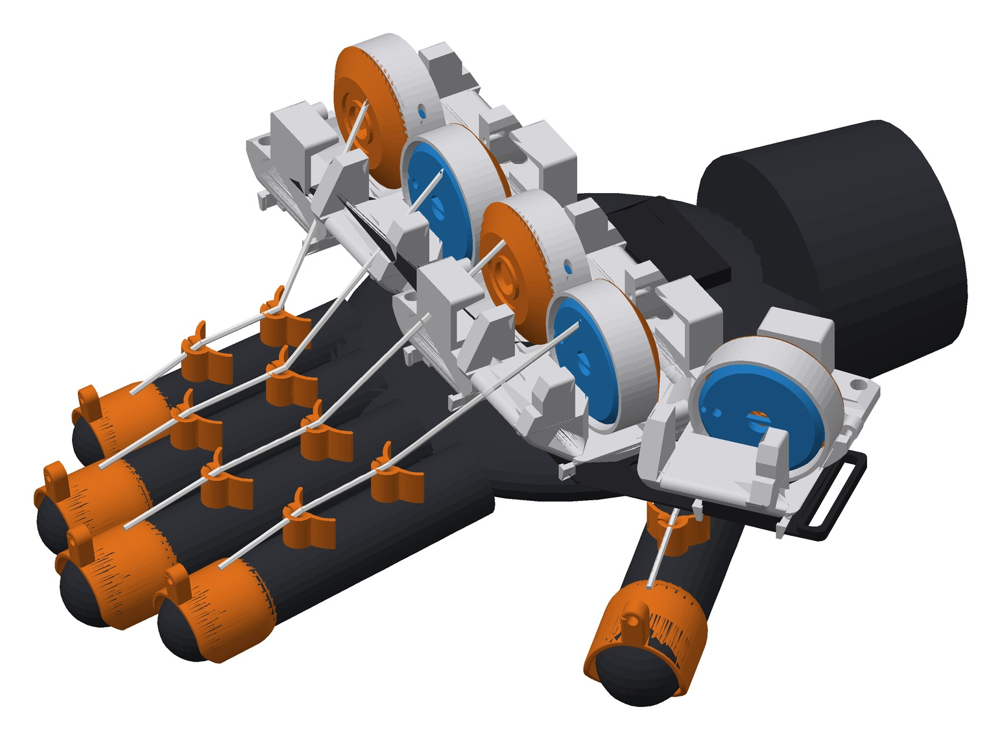

# VR Force Feedback Gloves (ESP32) - Prototype 4.1

Low-cost 3D printed gloves for SteamVR. On each hand, five string spools with rotary potentiometers track how far every finger bends, and five MG90S micro servos can lock the spools so you feel virtual objects you grab. An ESP32 per hand sends the data over USB or Bluetooth to the free OpenGloves driver. The printed mount sliders attach the gloves next to Quest 2 controllers or Vive 3.0 trackers.

Remix of [LucidGloves](https://github.com/LucidVR/lucidgloves) by LucidVR / Lucas_VRTech, updated/refurbished for modern use. Print files unchanged.

## Install and build guide

### What you are building

A pair of low-cost VR gloves that track how far each finger is bent and can stop your fingers when you grab a virtual object.

- Each finger has a printed module: a string runs from a cap on the fingertip, along guide nodes on the glove, to a spool on the back of the hand. A badge-reel spring pulls the string back and a 10 kOhm rotary potentiometer measures how far the spool has turned.
- A 9 g MG90S servo next to each spool can swing into the spool's path and lock it: that is the force feedback.
- One ESP32 per hand reads the five potentiometers, drives the five servos, and talks to the PC over USB or Bluetooth. On the PC, the OpenGloves driver for SteamVR turns the data into hand poses.

This package is **Prototype 4.1** with the Prototype 4 parts it reuses. It is the newest version upstream with a complete parts list, printing guide and building tutorial; the Prototype 5 files upstream are a beta without those.

The gloves do not track hand position. You strap them next to your VR controllers or trackers using the printed mount sliders (Quest 2 or Vive Tracker 3.0 slider included).

Parts for two hands are in the Bill of Material PDF. You also need a 3D printer, a soldering iron, pliers and a PC with SteamVR.

### 1. Set up and flash the firmware first

Test each ESP32 with the firmware before you wire it into a glove.

1. Install the Arduino IDE. In File > Preferences add the board URL https://raw.githubusercontent.com/espressif/arduino-esp32/gh-pages/package_esp32_index.json, then install **esp32 by Espressif Systems** in the Boards Manager.
2. Install the **ESP32Servo** library (by Kevin Harrington) in the Library Manager.
3. If Windows does not show a COM port when you plug the board in, install the Silicon Labs CP210x USB-UART driver. Use a data-capable USB cable.
4. Download the upstream firmware at the pinned commit: https://github.com/LucidVR/lucidgloves/tree/76472c70887689ae97e4fb4f5a976eb6d715a191/firmware/lucidgloves-firmware and open `lucidgloves-firmware.ino`. All settings live in `Config.h` (and `AdvancedConfig.h`).
5. Edit `Config.h` for this build:
   - `COMMUNICATION`: leave `COMM_SERIAL` for USB, or set `COMM_BTSERIAL` for Bluetooth.
   - `BTSERIAL_DEVICE_NAME`: `"lucidgloves-left"` for the left glove; change it to `"lucidgloves-right"` for the right glove.
   - **Change `PIN_MENU_BTN` from 34 to a free pin, for example 4.** In the ESP32 section of this firmware version the menu button shares GPIO 34 with the middle-finger potentiometer, so bending the middle finger would also press the menu button. GPIO 34 is an input-only pin without an internal pull-up, so it cannot work as a button pin anyway.
   - Leave `USING_FORCE_FEEDBACK true` and `USING_CALIB_PIN true`.
6. Select **ESP32 Dev Module** as the board, choose the port and upload.
7. Open the Serial Monitor at 115200 baud (USB mode). You should see a stream of lines of letters and numbers, for example `A2301B2391C3431...`; each letter is a channel and the number its value. Turning a potentiometer on a finger pin changes its number.

The firmware has not been changed for this remix. If a very new ESP32 board package fails to compile it, install an older 2.0.x release of the esp32 package and try again.

### 2. Print the parts

Print in PLA, 0.4 mm nozzle, 0.2 mm layers, 10-20 % infill, 2 perimeters, no supports (a brim is fine). All parts print flat. Per hand you need:

| Part | Qty per hand | File |
|---|---|---|
| Haptic spool | 5 | HapticSpool_Proto4.1.STL |
| Spool cover | 5 | Proto4_SpoolCover_open.STL |
| Tensioner | 5 | Proto4_Tensioner_GreenPot.STL (or Proto4_Tensioner_WLPot.STL for WL pots) |
| Pot holder | 5 | GreenPotSildeHolder_Proto4.1.STL for the rigid mount (WL and elastic-mount versions included) |
| Guide node | 2+ per finger, 1+ for the thumb | GuideNode_upgraded.STL |
| End cap | 5 | Proto4_Prot4_EndCap.STL, scaled to each finger |
| Rigid mount | 1 | Proto4_RigidMount_leftHand.STL or Proto4_RigidMount_rightHand.STL |
| Mount slider | 1 | Proto4_Quest2_MountSlider.STL or Vive3.0_MountSlider_v1.2.STL |
| ESP32 holder (optional) | 1 | ESP32_Wroom_Holder_Desoldered_JST.STL |

The Bill of Material uses the small green RK097N potentiometers, so print the GreenPot tensioner and holder. End caps must fit your fingers: scale them in the slicer, and squash them slightly in one direction so they sit on the oval finger shape and do not rotate. Printing them in TPU also works.

### 3. Build the finger modules

1. Fit a potentiometer into each pot holder (square hole for green pots) and fix it with its nut.
2. Take the badge reels apart for their spring and string. With pliers remove the metal loop from each reel end and clamp it onto the plastic loop on the holder; the finger string runs through this loop.
3. Assemble the spool on the potentiometer shaft with the tensioner and spool cover. Upstream shows this step in video: Prototype 3.1 tutorial https://youtu.be/Qj4hqRKiy8g?t=231 (3:51 to 5:52; the spool is built the same way) and the Prototype 4/4.1 tutorial https://www.youtube.com/watch?v=2yF-SJcg3zQ.
4. Check that each string pulls out smoothly and retracts by itself, and that the potentiometer turns over its range without hitting the end stop. A little lubricant in the potentiometer makes it smoother (upstream suggests WD-40; it is flammable, so use it sparingly and let it air out).

### 4. Glove and mount

1. Glue a layer of self-adhesive foam under the rigid mount.
2. Thread a 20 mm hook-and-loop strap through the two loops of the rigid mount and trim it so it holds firmly on the back of your hand. Optionally add an elastic loop through the two round holes in front of the thumb.
3. With the mount on your hand, slide the five modules onto it. Depending on hand size some modules may need to go on backwards so the string leaves at the right place.
4. Put on the glove and mark where the guide nodes and end caps go: an end cap on each fingertip, two or more guide nodes along each finger, one or more on the thumb. Glue them on with super glue (not while wearing the glove), then run each string from the end cap through the nodes to its module (upstream video https://youtu.be/Qj4hqRKiy8g?t=363 shows gluing and stringing).

### 5. Wiring

Pin numbers below come from the ESP32 section of `Config.h` in the pinned firmware. The upstream wiki has an older pin table that does not match this firmware; follow this one (or change `Config.h` to match your wiring).

| Function | ESP32 GPIO | Connection |
|---|---|---|
| Pinky potentiometer | 32 | wiper (middle pin) |
| Ring potentiometer | 35 | wiper |
| Middle potentiometer | 34 | wiper |
| Index potentiometer | 39 | wiper |
| Thumb potentiometer | 36 | wiper |
| Pinky servo | 19 | signal |
| Ring servo | 18 | signal |
| Middle servo | 5 | signal |
| Index servo | 17 | signal |
| Thumb servo | 16 | signal |
| Calibration button | 15 | button to GND |
| A button / B button (optional) | 27 / 14 | button to GND |
| Menu button (optional, after the change in step 1) | 4 | button to GND |

- **Potentiometers:** outer pins to the ESP32 **3.3 V** and **GND** (not 5 V; the ESP32 inputs take at most 3.3 V), middle pin to the GPIO.
- **Buttons:** between the GPIO and GND; the firmware turns on the internal pull-ups. Trigger, grab and pinch come from finger gestures, so no buttons are needed for them.
- **Servos:** signal to the GPIO. Power the five servos from a separate 5 V supply: one output of the power bank through the USB-A pigtail cable (red to servo +5 V, black to servo GND). Power the ESP32 from the second output with its USB cable. **Connect the servo GND to an ESP32 GND pin**, otherwise the servo signals have no reference. Do not power five servos from the ESP32's own pins.
- Keep the wiring flexible where it crosses the back of the hand; silicone wire and heat shrink help.

### 6. SteamVR and first run

1. Install SteamVR and the free **OpenGloves** driver from Steam (https://store.steampowered.com/app/1574050/OpenGloves/).
2. In the OpenGloves settings choose serial (USB) or Bluetooth to match the firmware. For USB select the COM port of each glove; for Bluetooth pair the gloves in Windows first (named lucidgloves-left and lucidgloves-right).
3. Calibrate: the firmware calibrates continuously by default. After power-up open and close each hand fully a few times so it learns the range. Press the calibration button to reset the range at any time.
4. In SteamVR check that every finger follows. If a finger moves backwards, set `FLIP_FLEXION` in `Config.h`, or swap the two outer potentiometer wires.

### 7. Set up the force feedback

Do this after finger tracking works.

1. Fit each servo into the slot next to its spool.
2. Put the single-arm servo horn on the servo, then find the right horn angle by trial: use the buttons in the OpenGloves app that extend and retract all servos. When extended, the horn must stop the spool so the finger is held open; when retracted it must not touch the spool at all.
3. Fix the horn screws and test grabbing an object in a VR game that supports OpenGloves force feedback.

### Troubleshooting

- **No serial data:** wrong port, charge-only cable, or missing CP210x driver.
- **Middle finger triggers the menu:** `PIN_MENU_BTN` is still 34 (step 1.5).
- **Fingers jitter or the ESP32 resets when servos move:** servos are powered from the ESP32, or the grounds are not joined; use the separate supply and a common GND.
- **Bluetooth drops:** power the ESP32 from its own clean supply (second output), keep the board antenna clear of metal.
- **Finger never reaches fully open/closed:** recalibrate; check the string is not slipping and the potentiometer does not reach its end stop.

### Safety

- Servos can pinch; keep fingers away from the horns while testing.
- The force feedback only holds the strings; do not use the gloves to restrain the hand against strong forces.
- Use a power bank with built-in protection, and do not cover it while charging.

### Credits

LucidGloves by LucidVR / Lucas_VRTech, MIT licence (Copyright (c) 2021 LucidVR). OpenGloves driver by LucidVR. Full notices are in the GitHub repository.

## Bill of Material and build guide (PDF)

- [Bill of Material (PDF)](docs/VR%20Force%20Feedback%20Gloves%20%28ESP32%29%20-%20remix%20of%20LucidGloves%20-%20Bill%20of%20Material.pdf) - every part to buy, with shop links.
- [Build Guide (PDF)](docs/VR%20Force%20Feedback%20Gloves%20%28ESP32%29%20-%20remix%20of%20LucidGloves%20-%20Build%20Guide.pdf)

## Repository contents

- `source/upstream/` - the original LucidGloves repository at commit `76472c70`: print files for Prototypes 3 to 5 (`hardware/`; this guide uses Prototype 4.1 with the Prototype 4 parts it reuses), the firmware (`firmware/lucidgloves-firmware/`), README files and the MIT `LICENSE`. The Wi-Fi settings in `Config.h` are the upstream placeholders.
- `docs/` - this build guide as Markdown and PDF, the Bill of Material PDF, and the upstream file manifest with hashes.
- `images/` - cover image.

## Credits and license

Original design, code and documentation: LucidVR / Lucas_VRTech, LucidGloves - https://github.com/LucidVR/lucidgloves (commit `76472c70`).

Licensed under the [MIT License](https://opensource.org/license/mit) - see `LICENSE` (the upstream licence text, also kept at `source/upstream/LICENSE`).

Changes in this repository: a rewritten build guide, a current Bill of Material, a new cover render of the print files and this repository layout. The print files and source are unchanged.
